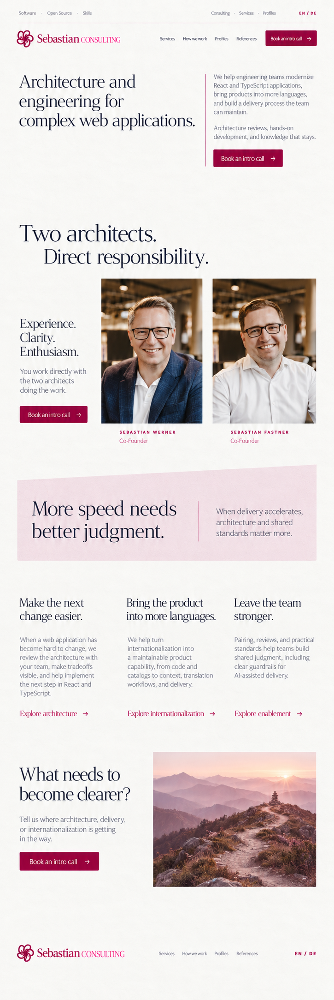
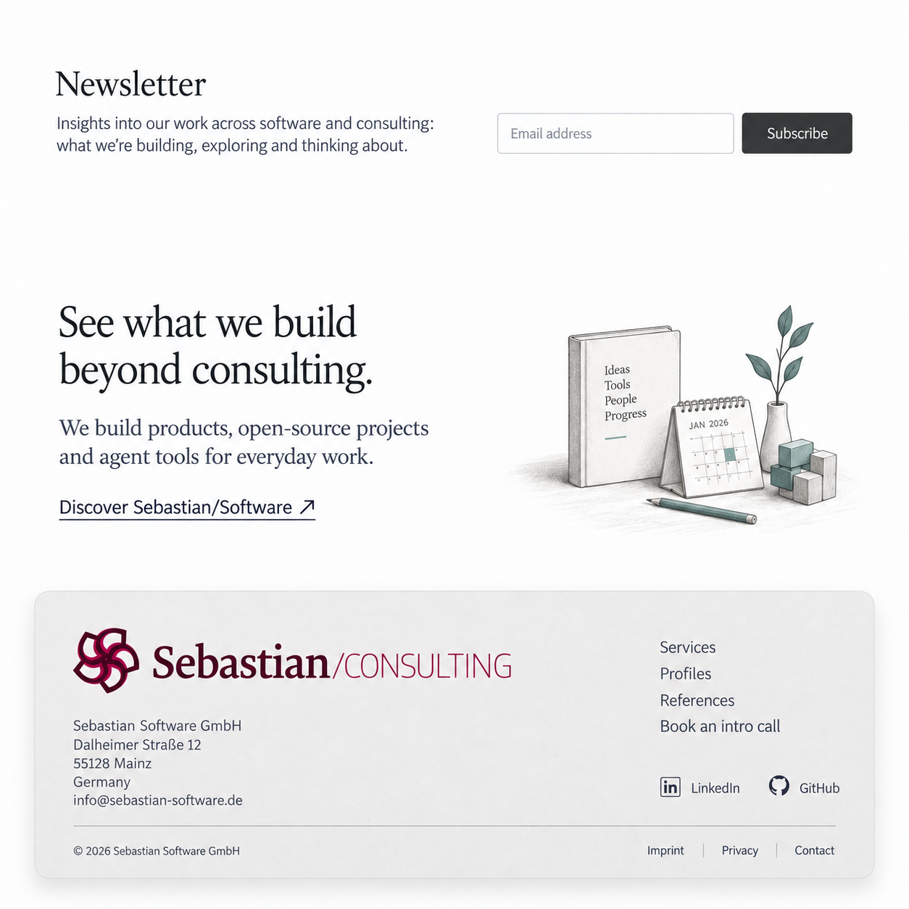

# Consulting homepage design

The selected concept leads with architecture and engineering for complex web applications, gives both founders equal portrait frames, uses one contained pink judgment passage, and closes with a visible trail toward an overlook. This directory prepares design assets for the planned Consulting application.

These are visual concepts. The reusable source images are collected in [app/assets](../app/assets/README.md). [Asset metadata](asset-manifest.json) records their dimensions, origin, and checksums; [exact reconstruction prompts](asset-prompts.json) record the built-in ImageGen requests.

## Technical editorial illustrations

The service illustrations use graphite, off-white, aluminum, and glass on a
near-white neutral background, with small burgundy accents. The
[reusable illustration prompt](illustration-prompt.md) provides the base prompt,
style reference, and subject examples for extending this visual language.

The [service illustration sources](../app/components/service-illustrations/README.md)
include the selected assets and their exact generation prompts.

## Selected Consulting homepage, revision 9

## Shared frame and current page ending

Use the [implementation brief](../../../design/IMPLEMENTATION-BRIEF.md) for the
current requirements, founder representation, and completion criteria.

Implementation is tracked in [#19](https://github.com/sebastian-software/sebastian-websites/issues/19),
with the shared frame in [#16](https://github.com/sebastian-software/sebastian-websites/issues/16).

The [current frame gallery](../../../packages/ui/design/refinements-r5/README.md) gives the current website the only logo and presents the other website as an editorial outward invitation. It supersedes the frame areas in the earlier homepage reference.

The sequence is shared newsletter, illustrated Software invitation, then the inset Consulting footer.

