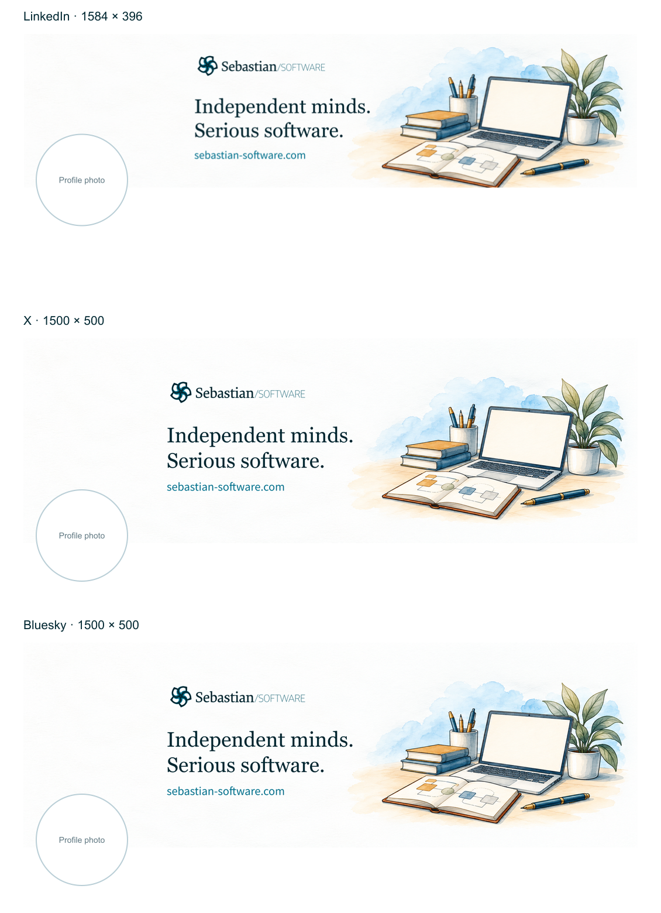

# Social profile assets: Sebastian Werner

The banners applied to LinkedIn, X, and Bluesky on October 30, 2026 use the
headline **Independent minds. Serious software.**

This folder stores off-site brand assets. It is not served by the website or
included in an application build.

## Upload files

| Platform | Size       | PNG                                             | Layered SVG                                     |
| -------- | ---------- | ----------------------------------------------- | ----------------------------------------------- |
| LinkedIn | 1584 × 396 | [PNG](exports/linkedin-banner-1584x396-v6a.png) | [SVG](exports/linkedin-banner-1584x396-v6a.svg) |
| X        | 1500 × 500 | [PNG](exports/x-banner-1500x500-v6a.png)        | [SVG](exports/x-banner-1500x500-v6a.svg)        |
| Bluesky  | 1500 × 500 | [PNG](exports/bluesky-banner-1500x500-v6a.png)  | [SVG](exports/bluesky-banner-1500x500-v6a.svg)  |

The selected smiling portrait applied to LinkedIn and Bluesky is preserved as
[portrait-upload.jpg](exports/portrait-upload.jpg). It is the public upload
export; the private photograph original remains outside this repository.
The banner build leaves this JPEG unchanged.



The overview's circles illustrate profile-photo placement; they are not part
of the upload files. LinkedIn has an extra 90 px horizontal text inset to keep
the website address clear of the profile photo.

## Source layers

- `sources/workbench-background.png`: the selected watercolor illustration,
  created with the built-in Imagegen tool from the Software website's style.
- `sources/imagegen-prompts.json`: the generation request and composition refinement.
- `sources/logo-software.original.svg`: the supplied original vector logo. The
  builder omits its solid artboard rectangle and preserves its paths and colors.
- `sources/*.outlines.json`: Georgia headline and Source Sans Pro website text
  as portable vector contours. Rendering requires no font binaries.
- `design.json`: copy, font names, colors, and per-platform positioning.
- `manifest.json`: output dimensions, byte sizes, hashes, and applied revision.

The SVG exports embed the illustration and retain separate vector groups for
logo and text. Private portrait originals, font binaries, browser screenshots,
and intermediate proposals are kept outside this public repository.

## Rebuild

This asset package is independent of the pnpm application workspaces. From
this directory, install its pinned renderer and rebuild the committed exports:

```sh
npm install
npm run build
```

The renderer uses Sharp 0.35.5 and enforces a 1 MB PNG upload budget. It rebuilds
exports, previews, and the manifest from the saved illustration and outlines;
it does not call Imagegen. PNG byte hashes can vary across renderer runtimes.

For a copy or font change, edit `design.json`, then regenerate outlines on macOS:

```sh
npm run outline
npm run build
```

Georgia is supplied by macOS. Install Source Sans Pro locally, or update its
`fontPath` in `design.json`; `~` expands to the current home directory. The
outline script checks each font's PostScript name. Font files are not committed.
After regeneration, run the repository's formatting check (`pnpm format:root`).
